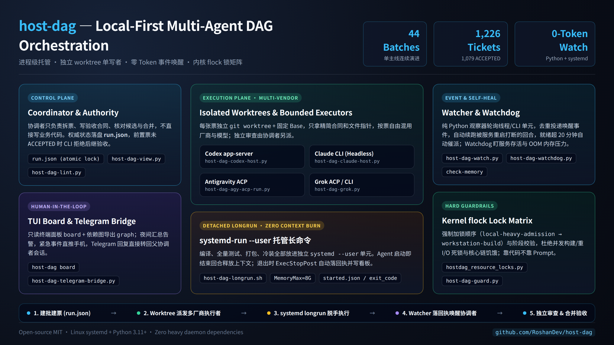
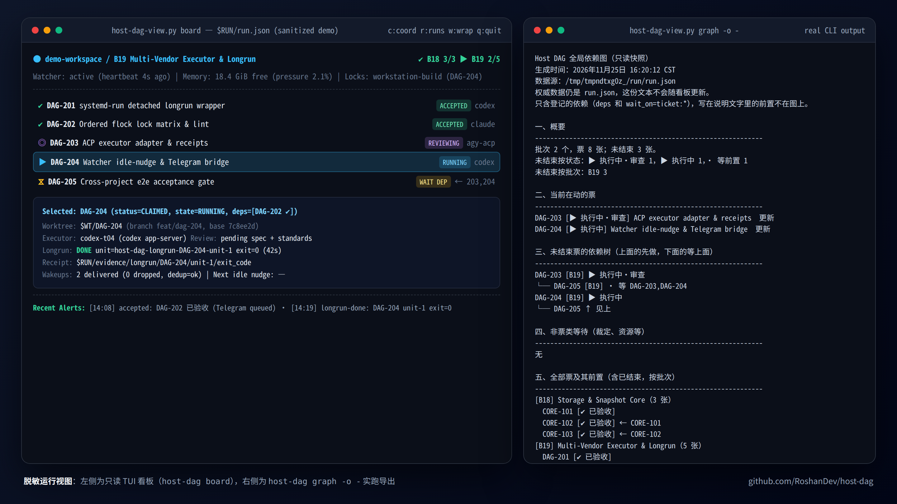

# host-dag

[简体中文](README.md) | **English**

Local-first multi-agent DAG orchestration built for long-running, unattended software engineering on Linux workstations.

One coordinator session breaks approved work into DAG tickets, dispatches bounded executors into isolated `git worktree` checkouts (Codex app-server, Claude CLI, Antigravity ACP, or Grok ACP), hosts long commands as independent `systemd --user` units, wakes the coordinator via a lightweight zero-token Python watcher, and exposes a read-only terminal board (`board`), dependency graph export (`graph`), kernel `flock` resource lock matrix, watchdog, and Telegram bridge.



## Why host-dag

Running multi-agent workflows over hundreds of tickets reveals three failure modes that chat-style message streams do not solve on their own:

1. **Process lifecycle & context burn**: Letting an agent `sleep` or poll inside a turn while waiting for a 30-minute build/test/package wastes context and dies on timeout or OOM. `host-dag-longrun.sh` runs long commands inside `systemd-run --user` units, ends the turn immediately, and writes atomic receipts on exit so the watcher wakes the coordinator.
2. **Workstation & host resource contention**: Concurrent agents fighting over builds, heavy I/O, or shared test hosts deadlock or starve critical chains. `hostdag_resource_locks.py` enforces ordered kernel `flock` leases and phase validation, paired with `host-dag-lint.py` for static board checks.
3. **Unattended drift & silent stalls**: `host-dag-watch.py` (plain Python, zero model tokens) tracks threads/units, deduplicates wakeups, auto-restarts interrupted turns, nudges idle ready tickets, and routes critical alerts or human replies through `host-dag-telegram-bridge.py`.

## Board & Dependency Graph Preview



## Repository Layout

| Path | Description |
|---|---|
| `SKILL.md` | Agent skill definition (`host-dag`) for Codex / Claude / Antigravity / Grok |
| `references/` | Detailed guides for Codex app-server (`codex-app-server.md`) and observer/watchdog (`observer.md`) |
| `scripts/host-dag-view.py` | Read-only TUI (`board`), dependency graph export (`graph`), `peek`, and atomic `batch/ticket set` CLI |
| `scripts/host-dag-watch.py` | Event-driven watcher: polls threads/CLI units, writes wakeups, nudges idle tickets |
| `scripts/host-dag-watchdog.py` | Health watchdog for app-server / watcher services and memory pressure alerts (`check-memory`) |
| `scripts/host-dag-longrun.sh`, `hostdag_longrun.py` | Detached `systemd-run --user` runner for long builds/tests with receipt tracking |
| `scripts/host-dag-codex-host`, `host-dag-codex-host.py` | Native Codex app-server adapter (`thread start/send/read/cancel`) |
| `scripts/host-dag-claude-host.py` | Headless Claude CLI host adapter implementing the same `thread` interface |
| `scripts/host-dag-cli-agent.py` | Unified systemd-hosted runner for CLI executors/reviewers |
| `scripts/host-dag-agy-acp-run.py`, `host-dag-agy-run.py` | Antigravity ACP / CLI executor wrappers |
| `scripts/host-dag-grok.py` | Grok ACP executor wrapper |
| `scripts/host-dag-lint.py` | Static DAG/board health linter |
| `scripts/host-dag-guard.py` | Managed host liveness guard (alerts via BMC instructions on prolonged outage) |
| `scripts/host-dag-telegram-bridge.py`, `host-dag-alert.py` | Desktop notifications + Telegram bridge (quiet-hour digest, urgent bypass, reply forwarding) |
| `scripts/dag-dispatch-lib.example.sh` | Config-driven shell helpers (`bset`, `codex_go`, `opus_rv`, `advisor_go`) |
| `scripts/hostdag_*.py` | Core state machine (`hostdag_dag_core.py`, `hostdag_ticket_state.py`), lock matrix (`hostdag_resource_locks.py`), self-heal, view cache, token guard |
| `docs/adopt-in-other-project.md` | Quickstart & copy-paste isolated empty-project end-to-end demo |

## Quick Start & End-to-End Demo

See [docs/adopt-in-other-project.md](docs/adopt-in-other-project.md) for a self-contained bash demo that creates a temporary git repo, registers two dependent tickets (`DEMO-A` → `DEMO-B`), executes tests via `host-dag-longrun.sh`, wakes a fake coordinator via `host-dag-watch.py`, merges and accepts both tickets, prints the dependency graph, and cleans up all temporary units and directories on exit.

### Key Environment Variables

| Variable | Default | Purpose |
|---|---|---|
| `HOST_DAG_RUN` | *(required / `--run`)* | Path to run directory holding `run.json`, `watch.json`, and `evidence/` |
| `HOST_DAG_RUNS_INDEX` | `~/.local/state/host-dag/runs.json` | Global index of known runs for `host-dag-view.py runs` |
| `HOST_DAG_LONGRUN_UNIT_PREFIX` | `host-dag-longrun` | `systemd --user` unit prefix for detached long commands |
| `HOST_DAG_CLI_UNIT_PREFIX` | `host-dag-cli` | `systemd --user` unit prefix for CLI executor/reviewer runs |
| `HOST_DAG_WATCH_NOTIFY` | `1` | Set to `0` to suppress desktop notifications (useful in tests/demos) |
| `HOST_DAG_TELEGRAM_CONFIG` | `~/.config/host-dag/telegram.env` | Telegram bot config path (set `/dev/null` to disable) |
| `HOST_DAG_PAGE_WINDOW_PYTHON` | `sys.executable` | Python interpreter used for optional browser/page-window helpers |

## Running Tests

Requires Python 3.11+ (tested on 3.14). `test_hostdag_codex_host.py` requires the `websockets` package; `test_hostdag_host_watch.py` requires an explicit `TMPDIR` outside `/tmp` and `$HOME` root.

```bash
mkdir -p "$HOME/.cache/host-dag-test-tmp"
TMPDIR="$HOME/.cache/host-dag-test-tmp" \
HOST_DAG_WATCH_NOTIFY=0 \
PYTHONPATH="$PWD/scripts:$PWD/scripts/tests" \
python3 -m unittest discover -s scripts/tests -p 'test_*.py'
```

## License

[MIT](LICENSE)
