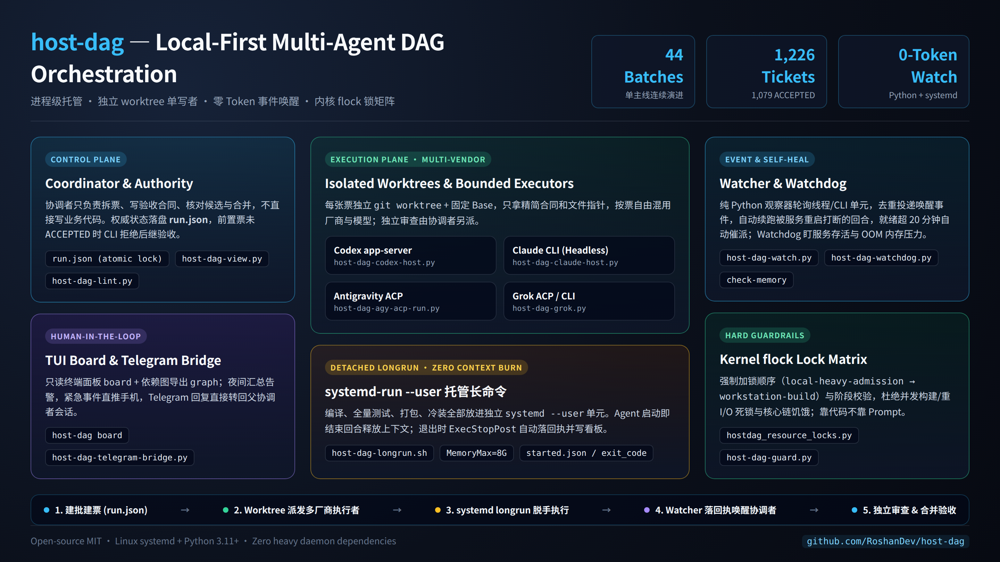
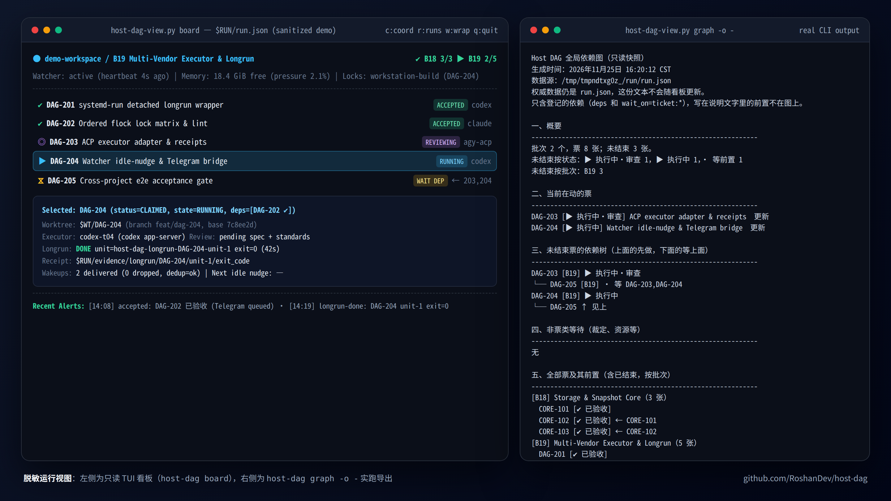

# host-dag

**简体中文** | [English](README.en.md)

面向 Linux 工作站长程、无人值守研发场景的本地优先多 Agent DAG 编排工具。

由一个协调者会话将已批准的任务拆成 DAG 票据，把有边界的执行者派发到独立的 `git worktree` 中（支持 Codex app-server、Claude CLI、Antigravity ACP、Grok ACP 混用），将长耗时命令托管为独立的 `systemd --user` 单元，由轻量零 Token 的 Python watcher 驱动唤醒协调者，并配套只读终端看板（`board`）、依赖图导出（`graph`）、内核 `flock` 资源锁矩阵、看门狗（`watchdog`）和 Telegram 双向桥接。



## 为什么做 host-dag

在真实工程项目里把多 Agent 连续跑过上千张票之后，有三个最常见、也最致命的故障模式，单靠聊天消息流无法解决：

1. **进程生命周期与上下文白烧**：让 Agent 在会话里 `sleep` 或轮询等待一场 30 分钟的构建、全量测试或打包，既烧上下文，又容易被超时或 OOM 一起带走。`host-dag-longrun.sh` 把所有长命令放进 `systemd-run --user` 独立单元，Agent 启动即结束回合释放上下文；退出时由 `ExecStopPost` 落原子回执并写看板，由 watcher 负责唤醒协调者。
2. **工作站与主机资源争抢**：多个 Agent 同机并发争抢构建、重 I/O 或共享测试机，极易触发死锁或把核心链饿死。`hostdag_resource_locks.py` 强制校验内核 `flock` 加锁顺序与阶段规则，配合 `host-dag-lint.py` 静态巡检，靠代码而不是靠 Prompt 约束并发。
3. **无人值守漂移与静默卡死**：`host-dag-watch.py`（纯 Python，不消耗模型 Token）统一跟踪线程与 CLI 单元、去重投递唤醒事件、自动续跑被服务重启打断的回合、对就绪超过 20 分钟无人管的票自动催派，并通过 `host-dag-telegram-bridge.py` 做夜间汇总、紧急直推和手机回复回传。

## 看板与依赖图预览



## 目录结构

| 路径 | 说明 |
|---|---|
| `SKILL.md` | 通用 Agent Skill 定义（`host-dag`），适用于 Codex / Claude / Antigravity / Grok |
| `references/` | Codex app-server 接线指南（`codex-app-server.md`）与观察器/看门狗文档（`observer.md`） |
| `scripts/host-dag-view.py` | 只读 TUI 看板（`board`）、全局依赖图导出（`graph`）、会话追踪（`peek`）与原子状态写入 CLI（`batch/ticket set`） |
| `scripts/host-dag-watch.py` | 事件驱动观察器：轮询线程与 CLI 单元、落唤醒消息、空闲票自动催派 |
| `scripts/host-dag-watchdog.py` | 服务健康看门狗（盯 app-server / watcher 存活）与内存压力预警（`check-memory`） |
| `scripts/host-dag-longrun.sh`, `hostdag_longrun.py` | 基于 `systemd-run --user` 的脱手长命令托管器与回执记录 |
| `scripts/host-dag-codex-host`, `host-dag-codex-host.py` | 原生 Codex app-server 适配器（`thread start/send/read/cancel`） |
| `scripts/host-dag-claude-host.py` | 无头 Claude CLI 宿主适配器，实现与 Codex 宿主一致的 `thread` 接口 |
| `scripts/host-dag-cli-agent.py` | 统一的 systemd 托管 CLI 执行者 / 审查者运行器 |
| `scripts/host-dag-agy-acp-run.py`, `host-dag-agy-run.py` | Antigravity ACP / CLI 执行者包装器 |
| `scripts/host-dag-grok.py` | Grok ACP 执行者包装器 |
| `scripts/host-dag-lint.py` | 静态 DAG / 看板健康巡检 |
| `scripts/host-dag-guard.py` | 受管宿主机存活守卫（长时间失联时推送含 BMC 指引的紧急告警） |
| `scripts/host-dag-telegram-bridge.py`, `host-dag-alert.py` | 桌面通知与 Telegram 双向桥接（夜间静默汇总、紧急告警直推、回复直转协调者） |
| `scripts/dag-dispatch-lib.example.sh` | 配置驱动的 Shell 派发辅助库（`bset`、`codex_go`、`opus_rv`、`advisor_go`） |
| `scripts/hostdag_*.py` | 核心状态机（`hostdag_dag_core.py`、`hostdag_ticket_state.py`）、锁矩阵（`hostdag_resource_locks.py`）、自愈、视图缓存与 token 守卫 |
| `docs/adopt-in-other-project.md` | 跨项目接入指南与可直接复制运行的隔离空项目端到端演示 |

## 快速开始与空项目端到端演示

详见 [docs/adopt-in-other-project.md](docs/adopt-in-other-project.md)，内含一段可直接复制执行的隔离 `bash` 演示脚本：在临时目录初始化空 Git 仓库、登记两张依赖票（`DEMO-A` → `DEMO-B`）、校验依赖守卫、通过 `host-dag-longrun.sh` 托管跑测、由 `host-dag-watch.py` 唤醒协调者桩、合并验收、导出依赖图，并在退出时自动清场读回确认。

### 常用环境变量

| 环境变量 | 默认值 | 用途 |
|---|---|---|
| `HOST_DAG_RUN` | *(必填或经 `--run` 指定)* | run 目录路径（存放 `run.json`、`watch.json` 与 `evidence/`） |
| `HOST_DAG_RUNS_INDEX` | `~/.local/state/host-dag/runs.json` | 供 `host-dag-view.py runs` 查询的全局 run 索引 |
| `HOST_DAG_LONGRUN_UNIT_PREFIX` | `host-dag-longrun` | 脱手长命令的 `systemd --user` 单元名前缀 |
| `HOST_DAG_CLI_UNIT_PREFIX` | `host-dag-cli` | CLI 执行者 / 审查者的 `systemd --user` 单元名前缀 |
| `HOST_DAG_WATCH_NOTIFY` | `1` | 设为 `0` 可静默桌面通知（适合测试与演示） |
| `HOST_DAG_TELEGRAM_CONFIG` | `~/.config/host-dag/telegram.env` | Telegram Bot 配置文件路径（设为 `/dev/null` 可关闭） |
| `HOST_DAG_PAGE_WINDOW_PYTHON` | `sys.executable` | 可选浏览器 / 页面窗口辅助脚本使用的 Python 解释器 |

## 运行测试

需要 Python 3.11+（已在 3.14 上实测）。其中 `test_hostdag_codex_host.py` 需要安装 `websockets` 包；`test_hostdag_host_watch.py` 要求显式指定不在 `/tmp` 与 `$HOME` 根目录下的 `TMPDIR`。

```bash
mkdir -p "$HOME/.cache/host-dag-test-tmp"
TMPDIR="$HOME/.cache/host-dag-test-tmp" \
HOST_DAG_WATCH_NOTIFY=0 \
PYTHONPATH="$PWD/scripts:$PWD/scripts/tests" \
python3 -m unittest discover -s scripts/tests -p 'test_*.py'
```

## 许可证

[MIT](LICENSE)
